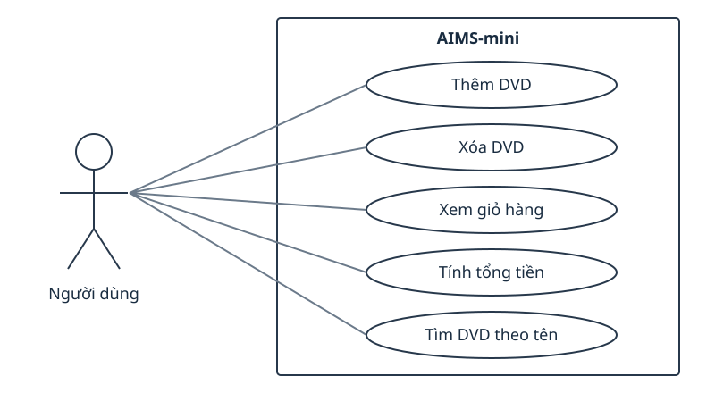

**Các ca sử dụng của AIMS-mini**

Tác nhân Người dùng tương tác với hệ thống để thêm hoặc xóa DVD, xem
giỏ hàng, tính tổng tiền và tìm DVD theo tên. Đây là các ca sử dụng logic;
`main.py` hiện minh họa một kịch bản cố định, chưa có menu tương tác.

| Ca sử dụng | Kết quả |
|---|---|
| Thêm DVD | DVD được đưa vào giỏ nếu chưa đạt giới hạn |
| Xóa DVD | DVD có trong giỏ được loại bỏ |
| Xem giỏ hàng | Hiển thị danh sách DVD hoặc thông báo giỏ trống |
| Tính tổng tiền | Cộng giá của những DVD đang có trong giỏ |
| Tìm DVD theo tên | Trả danh sách DVD có tên chứa chuỗi tìm kiếm |

Sơ đồ dùng actor, ellipse cho use case và khung giới hạn hệ thống theo
ký pháp UML. Không dùng quan hệ include/extend vì các ca sử dụng này
không cần thể hiện quan hệ phụ thuộc trong phạm vi bài thực hành.
